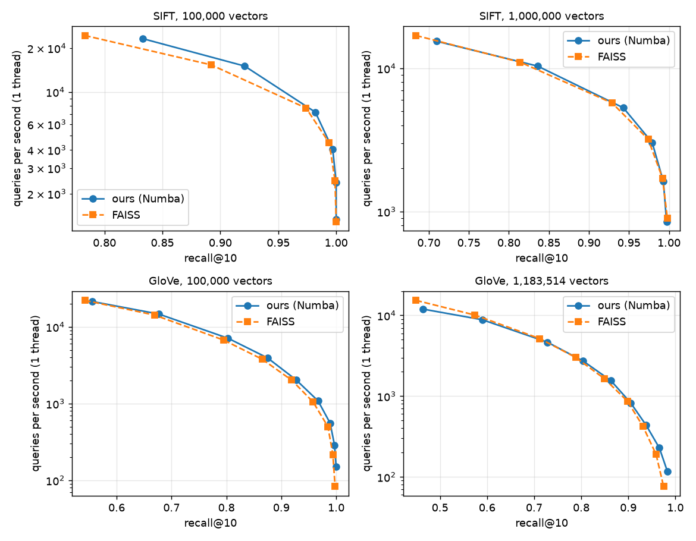

# ann-index

An approximate nearest neighbour index written from scratch in Python and NumPy. It is an HNSW graph index (Malkov and Yashunin, 2016), benchmarked against exact search and against FAISS on the SIFT dataset. The goal is an honest picture of how recall, speed and memory trade off.

## Status

Done: an exact baseline, HNSW in Python and in Numba, a comparison with FAISS on SIFT at 100,000 and 1,000,000 vectors, multi-threaded build and search, and product quantization. At equal recall our index is about 1.3 to 1.8 times slower than FAISS on one thread. It is 20 times faster than exact search at 1,000,000 vectors, and product quantization shrinks the index by a factor of five at 100,000 vectors. On GloVe, a harder dataset, the picture is the same but recall is much lower for the same ef, and at very high recall (ef = 3,200) our index matches or passes FAISS.

## Baseline

Exact brute-force search on the first 100,000 SIFT base vectors (128 dimensions), 1,000 queries, k = 10. The exact search code reproduces the ground truth that ships with SIFT (checked on 100 queries against the full 1,000,000 vectors).

| Method | Recall@10 | Queries per second | Memory |
|---|---|---|---|
| Exact, Euclidean | 1.00 | 811 | 51.2 MB |
| Exact, cosine | 1.00 | 862 | 51.2 MB |

Numbers come from one 4-core server and vary a little from run to run (880 queries per second in a later run). On all 1,000,000 vectors, exact search runs at 88 queries per second.

## Comparison with FAISS

FAISS `IndexHNSWFlat` against our Numba index (`annindex/hnsw_fast.py`), same data and parameters (M = 16, efConstruction = 100), one thread each, 1,000 queries, k = 10. The script is `faiss_compare.py`. FAISS memory is the size of its serialized index.

100,000 vectors. Build: ours 37.9 s and 61.9 MB, FAISS 21.1 s and 65.6 MB. Exact search: about 880 queries per second.

| ef | Ours: recall, queries per second | FAISS: recall, queries per second |
|---|---|---|
| 10 | 0.833, 13,672 | 0.783, 25,067 |
| 20 | 0.921, 9,091 | 0.892, 16,499 |
| 50 | 0.982, 4,552 | 0.974, 8,101 |
| 100 | 0.997, 2,654 | 0.994, 4,590 |
| 200 | 1.000, 1,500 | 0.999, 2,410 |
| 400 | 1.000, 873 | 1.000, 1,290 |

1,000,000 vectors (the full SIFT base set). Build: ours 586 s and 618.5 MB, FAISS 332 s and 656.3 MB. The raw vectors take 512 MB. Exact search: 88 queries per second.

| ef | Ours: recall, queries per second | FAISS: recall, queries per second |
|---|---|---|
| 10 | 0.710, 8,584 | 0.684, 16,303 |
| 20 | 0.836, 6,160 | 0.814, 10,525 |
| 50 | 0.943, 3,224 | 0.929, 5,357 |
| 100 | 0.979, 1,771 | 0.974, 3,161 |
| 200 | 0.993, 1,029 | 0.992, 1,630 |
| 400 | 0.997, 573 | 0.998, 871 |

At the same ef our recall is a little higher. We have not checked why, but the two libraries may not do the same amount of work for the same ef, so the fair comparison is recall against speed. Judged that way, FAISS answers about 1.3 times as many queries per second at 100,000 vectors and about 1.5 times as many at 1,000,000. At 1,000,000 vectors our index reaches recall 0.979 at 1,771 queries per second, 20 times faster than exact search.

A remaining gap to FAISS is expected. FAISS is tuned C++ with hand-vectorized distance code, while ours is Numba code with a plain loop for each distance.

## GloVe, a harder dataset

GloVe word vectors (100 dimensions, 1,183,514 base vectors, cosine distance) from ann-benchmarks. Same parameters (M = 16, efConstruction = 100), one thread, 1,000 queries, k = 10. FAISS gets unit-length vectors, since cosine ranking equals Euclidean ranking on those. Run with `python faiss_compare.py --dataset glove --n 100000`; logs are in `results/`.

100,000 vectors. Build: ours 49.9 s and 50.4 MB, FAISS 24.0 s and 54.4 MB. Exact search: 865 queries per second.

| ef | Ours: recall, queries per second | FAISS: recall, queries per second |
|---|---|---|
| 10 | 0.555, 14,496 | 0.542, 23,936 |
| 20 | 0.677, 8,871 | 0.669, 14,167 |
| 50 | 0.803, 4,353 | 0.795, 7,197 |
| 100 | 0.875, 2,404 | 0.865, 3,902 |
| 200 | 0.927, 1,287 | 0.919, 2,076 |
| 400 | 0.967, 724 | 0.958, 1,062 |
| 800 | 0.989, 370 | 0.985, 489 |
| 1,600 | 0.997, 171 | 0.994, 186 |
| 3,200 | 1.000, 98 | 0.998, 80 |

All 1,183,514 vectors. Build: ours 842 s and 594.5 MB, FAISS 457 s and 644.2 MB. The raw vectors take 473 MB. Exact search: 60 queries per second.

| ef | Ours: recall, queries per second | FAISS: recall, queries per second |
|---|---|---|
| 10 | 0.463, 8,481 | 0.449, 14,975 |
| 20 | 0.590, 5,906 | 0.574, 9,564 |
| 50 | 0.727, 3,016 | 0.712, 4,999 |
| 100 | 0.804, 1,766 | 0.788, 2,899 |
| 200 | 0.863, 979 | 0.849, 1,547 |
| 400 | 0.905, 529 | 0.898, 836 |
| 800 | 0.938, 284 | 0.931, 412 |
| 1,600 | 0.966, 148 | 0.959, 183 |
| 3,200 | 0.983, 77 | 0.975, 71 |

GloVe is much harder than SIFT. On 100,000 vectors ef = 100 gives recall 0.875, where SIFT gave 0.997, and on the full set it takes ef = 400 to pass 0.9. The word vectors have no clear clusters, so the graph search has to visit far more points to find the true neighbours. Even so, our index at ef = 100 on the full set answers 1,766 queries per second at recall 0.804, which is 29 times faster than exact search. The gap to FAISS is the same as on SIFT, about 1.4 to 1.6 times at equal recall, with our recall slightly higher at the same ef.

The rows for ef = 800 and above come from a second run (`results/glove_100k_high_ef.log` and `results/glove_full_high_ef.log`), so the numbers for ef = 100 and 400 there differ slightly from the first run. At very high recall the gap closes. On the full set, recall 0.966 takes 148 queries per second with our index and 183 with FAISS at ef = 1,600, but at ef = 3,200 ours reaches 0.983 at 77 queries per second against 0.975 at 71 for FAISS. At 100,000 vectors ours reaches recall 1.000 at 98 queries per second against 0.998 at 80. We have not checked why the curves cross. Exact search matters here too: at 100,000 vectors it handles 865 queries per second, which is faster than either index once recall is above about 0.95 (at ef = 400 ours reaches 0.967 at 724). On the full set exact search handles 60 queries per second, so the graph index is still ahead there, though only by a little at ef = 3,200.



## Threads

`HNSWFast.add(data, threads=4)` and `HNSWFast.search(queries, k, ef, threads=4)` use several threads. Searching splits the queries into chunks, one per thread, and returns the same answers as one thread. Building inserts the points in batches of 64. Each batch looks for neighbours in parallel against the graph built so far and is then linked in parallel, so points in the same batch do not see each other. Linking gives exactly the graph that adding the points one after another would give: each new point's own links are written on separate threads, and the links back to existing points are grouped by target and applied in node order. The graph therefore does not depend on the thread count, and `tests/test_hnsw_fast.py` checks that. That cost almost no recall (0.981 against 0.982 at ef = 50), and the first 2,000 points go in one at a time.

Four threads on 100,000 vectors, same parameters as above. Build: ours 15 s after parallelising the linking step (two runs, 15.2 s and 14.9 s; 22.8 s in the logged run below, which linked each batch in order, and 37 s on one thread), FAISS 6.3 s. The graph is identical in both versions, so the table below still holds.

| ef | Ours: recall, queries per second | FAISS: recall, queries per second |
|---|---|---|
| 10 | 0.831, 29,388 | 0.783, 49,016 |
| 20 | 0.918, 18,653 | 0.892, 47,934 |
| 50 | 0.981, 13,312 | 0.974, 23,288 |
| 100 | 0.997, 7,643 | 0.994, 13,372 |
| 200 | 1.000, 4,413 | 0.999, 7,484 |
| 400 | 1.000, 2,547 | 1.000, 4,004 |

Search speed grows about 3 to 4 times with four threads for both libraries, so the gap to FAISS stays the same. Multi-thread timings on this shared server vary by 20 to 30 percent between runs. The build gains less than the search; the first 2,000 points are still inserted on one thread.

## Product quantization

Product quantization (`annindex/pq.py`) splits each 128 dimensional vector into pieces, here 16 or 32, and replaces each piece by the number of its nearest centroid out of 256, found by k-means on 20,000 training vectors. A 512 byte vector becomes 16 or 32 bytes. A search computes a small table of distances from the query to every centroid, and the distance to a stored vector is then a sum of table lookups.

`annindex/hnsw_pq.py` searches the HNSW graph with these distances, so the raw vectors are not needed during the search. Results on 100,000 vectors, one thread. Raw vectors take 51.2 MB and the raw index with its graph takes 61.9 MB.

| Pieces | Memory (codes, codebooks, graph) | Recall from codes alone | Recall with a re-score of the ef candidates |
|---|---|---|---|
| 16 | 12.5 MB | 0.618 | 0.986 at ef = 100 |
| 32 | 14.1 MB | 0.756 | 0.995 at ef = 100 |

Searching through codes alone is limited by the quantization error. Recall stays at 0.62 (16 pieces) and 0.76 (32 pieces) however large ef is, which matches a full scan of the same codes. Re-scoring the candidates with the raw vectors restores recall to 0.986 and 0.995, and it is still faster than the raw search (5,093 queries per second against 2,957 at ef = 100 with 16 pieces) because code lookups are cheaper than 128 dimensional distances. The catch is that the raw vectors are still needed for the re-score, for example on disk, so this saves memory only if they are kept off the main memory. Full numbers for each ef value are in `results/pq_100k.log`.

## Speed work

The pure Python version (`annindex/hnsw.py`) gives the same recall as the Numba version at every ef value but runs far slower. On 20,000 vectors at ef = 50 it handled 698 queries per second, against 4,409 for the first Numba version (6.3 times faster). Exact search was faster than the Python version at that size, because NumPy runs it as one large matrix product while the Python search takes one step at a time.

Three changes made the difference, in this order. Batching the neighbour selection step in NumPy roughly halved the Python build time. Compiling the search and insert loops with Numba gave most of the gain. Turning on fast-math for the distance loop, which lets the compiler vectorize it, then nearly doubled the speed again without changing recall (build at 100,000 vectors fell from 81 s to 37 s). The Python version stays in the repo as a readable reference.

## Layout

- `annindex/exact.py`: exact k-NN search for Euclidean and cosine distance.
- `annindex/hnsw.py`: the HNSW index in plain Python, kept as a readable reference.
- `annindex/hnsw_fast.py`: the same algorithm with the graph in NumPy arrays and Numba-compiled loops.
- `annindex/pq.py`: product quantization, plus a scan over the codes.
- `annindex/hnsw_pq.py`: search the HNSW graph through PQ codes.
- `annindex/metrics.py`: recall@k.
- `annindex/data.py`: reads SIFT `.fvecs` files and makes random data.
- `bench.py`: build time, queries per second, recall and memory for any index.
- `sweep.py`: recall against queries per second for several values of `ef`.
- `faiss_compare.py`: our index against FAISS HNSW on the same data.
- `plot_results.py`: recall against queries per second plots from the logs in `results/`.
- `pq_bench.py`: recall, speed and memory with product quantization.
- `tests/`: checks against brute force.

## Reproduce

Download `sift.tar.gz` from `ftp://ftp.irisa.fr/local/texmex/corpus/sift.tar.gz`, then:

```
tar -xzf sift.tar.gz -C data sift/sift_base.fvecs sift/sift_query.fvecs sift/sift_groundtruth.ivecs
python bench.py --base data/sift/sift_base.fvecs --query data/sift/sift_query.fvecs --n 100000
python sweep.py --base data/sift/sift_base.fvecs --query data/sift/sift_query.fvecs --n 100000
python faiss_compare.py --n 100000 --threads 4
python pq_bench.py
python plot_results.py
python -m pytest
```

## Possible next steps

1. Hand-written SIMD distance code.
2. Store the raw vectors on disk for the re-score in the compressed index.
